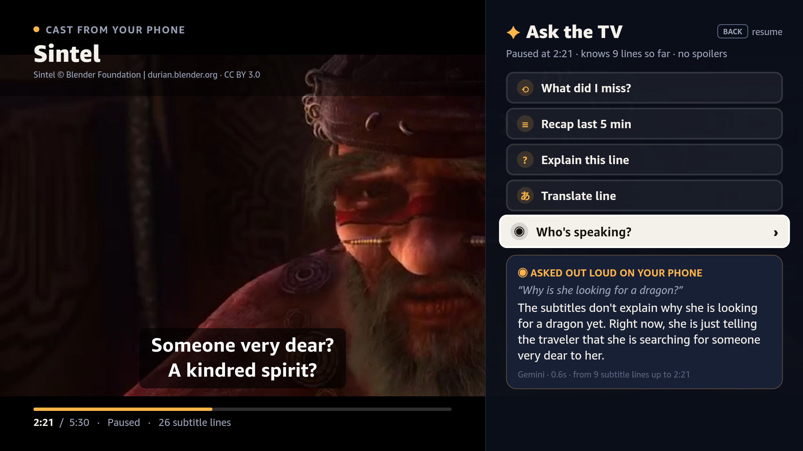
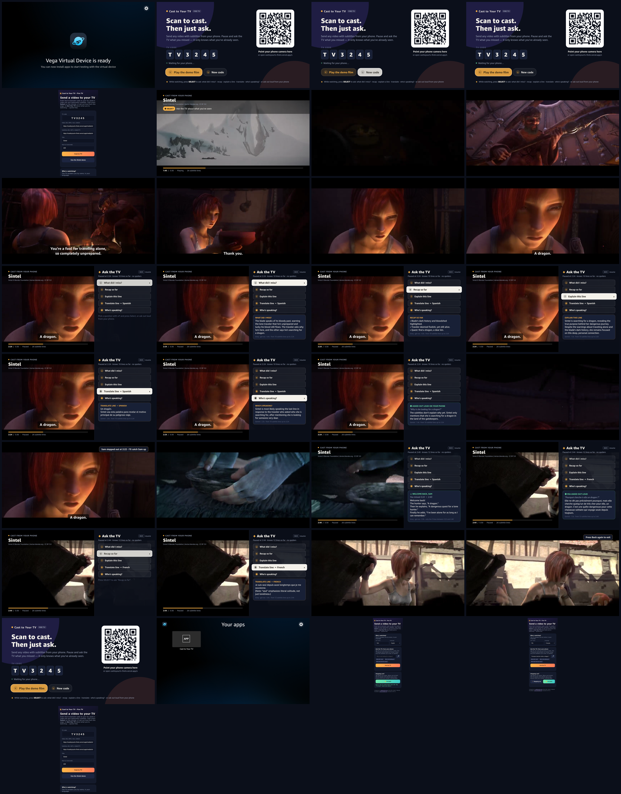

# Cast to Your TV for Fire TV (Vega OS)

[](https://github.com/OlsOls4/casttoyourtv-firetv/actions/workflows/firetv.yml)

A Fire TV receiver for [casttoyourtv.com](https://casttoyourtv.com/), built with **React Native for Vega** (Vega OS / SDK 0.24) for the Amazon *Build, Ship, Shape* hackathon (Fire TV track).

You scan a QR code on the TV and send a video and its subtitles from your phone. Then the hook: **Ask the TV**. Press **Select** while watching and the film pauses. A side panel opens with questions you pick with the D-pad:

| Chip | What you get |
|---|---|
| **What did I miss?** | A 2–3 sentence catch-up on the last minute or so |
| **Recap last 5 min** | Three short bullets |
| **Explain this line** | The meaning and subtext of the line just spoken |
| **Translate line** | The latest line in Spanish, plus a note on nuance |
| **Who's speaking?** | The most likely speaker, with the clue in the dialogue |

**Or ask out loud from your phone.** The page you cast from has a mic button (Web Speech API). Ask anything, like *"Why is she looking for a dragon?"*, and the TV pauses, shows your question and answers it on screen. Vega has no app-level speech-to-text yet, so the phone acts as the microphone while the remote stays in charge.



**No spoilers.** The model only sees subtitle cues that have already started, filtered on the TV and again on the server. It never gets the film's future dialogue.



▶ **Demo video (1080p, 2¾ min, recorded in CI on the VVD):** [docs/ask-the-tv-demo.mp4](docs/ask-the-tv-demo.mp4)

## Demo video and screenshots

Every CI run ([latest verified run](https://github.com/OlsOls4/casttoyourtv-firetv/actions/runs/39060876853)) boots the **Vega Virtual Device** on a free GitHub-hosted runner and drives the app with remote-key presses:

1. pair screen
2. the web sender page opened from the QR link (headless Chrome) casts through the relay
3. playback with subtitles
4. Ask the TV: all five questions
5. a free question asked from the phone page
6. resume
7. back

The run uploads screenshots, a 1080p MP4 and the `.vpkg` as the `firetv-demo` artifact ([Actions](https://github.com/OlsOls4/casttoyourtv-firetv/actions)). Selected frames live in [`docs/`](docs/), and every step is in [docs/contact-sheet-all-steps.png](docs/contact-sheet-all-steps.png).

## Architecture

```
 Phone / browser                       Vercel (serverless, free tier)                 Fire TV (Vega OS)
 ───────────────                       ───────────────────────────────                ─────────────────
 /s/?code=ABC123  ── POST cast ──►  /api/relay  ◄── GET poll every 2 s ───  Pair screen (QR + 6-char code)
 (web sender)                       (code → cast, phone questions)          │ cast received
                                                                                 ▼
                                    /media/* (demo MP4, SRT, poster)  ◄──  Player: W3C Media VideoPlayer
                                                                           + KeplerVideoSurfaceView
                                                                           + our own SRT/VTT cue overlay
                                                                                 │ Select = pause + Ask
                                    /api/ask  ◄── {mode, t, cues ≤ t} ────  Ask the TV panel (D-pad chips)
                                    Gemini (or Groq) with a strict              ▲
                                    "only these lines, no spoilers"             └─ offline fallback answers
                                    prompt → short answer                          if the network fails
```

* **App** (`app/`, generated with `vega project generate --template helloWorld`, then customised):
  * `src/App.tsx`: switches between the pair screen and the player.
  * `src/ct/PairScreen.tsx`: 10-foot pair screen. Big QR code (rendered with plain Views from `qrcode-generator`), the 6-character code, a live relay status, and D-pad-focusable **Play the demo film** and **New code** buttons.
  * `src/ct/PlayerScreen.tsx`: playback through `@amazon-devices/react-native-w3cmedia` (`VideoPlayer` + `KeplerVideoSurfaceView`). Subtitles are parsed by our own SRT/WebVTT parser (`subtitles.ts`) and drawn as an overlay. Left/right seek ±10 s, play/pause works, and Back closes the panel or exits. If the decoder doesn't advance (for example on an emulator without hardware video), a subtitle clock keeps the cues moving so the experience never dead-ends.
  * `src/ct/AskPanel.tsx` + `ask.ts`: the Ask the TV side panel. It sends `POST /api/ask` with only the cues up to the pause point, uses a 12 s timeout, and falls back to deterministic offline answers.
* **Backend** (`server/`, deployed at <https://casttoyourtv-firetv.vercel.app>):
  * `api/ask.js` + `lib/ask-core.js`: the spoiler-safe prompt. It tries Groq (Llama 3.3 70B) when `GROQ_API_KEY` is set, then Gemini (`gemini-flash-lite-latest`, falling back to other models), then the offline answer. The response includes `source`, `model`, `cuesUsed` and `ms`.
  * `api/relay.js`: the pairing relay. The sender POSTs a cast (or a `question`) for a code. The pair screen polls for casts, and the player polls with `&q=1` for phone questions. State lives in the warm function's memory (fine for a demo). Swap in Redis/KV for production.
  * `public/s/`: the web sender page that the QR code opens (`/s/?code=XXXXXX`). It casts, and it asks free questions by voice (Web Speech API) or by typing.
  * `public/media/`: the demo clip, its subtitles and a poster image.
* **CI** (`.github/workflows/firetv.yml`, `ci/scripts/`):
  * Uses the composite action [`OlsOls4/vega-vvd-ci`](https://github.com/OlsOls4/vega-vvd-ci). It installs the Vega SDK, enables KVM and boots the VVD headlessly with non-black captures.
  * `prepare-app.sh` writes the build-time config (a fixed pairing code per run, so CI can cast to it), runs the unit tests and builds `build:release`.
  * `demo.sh` drives the app with `inputd-cli button_press`. It casts through the real web sender page, then captures screenshots and records with the emulator console's `screenrecord`.

## Run it yourself

**On a machine with the Vega SDK 0.24 and Node 22 (Linux x86_64 or macOS):**

```bash
cd app
npm install
npm run build:release                      # -> build/x86_64-release/casttoyourtv_x86_64.vpkg (+ aarch64/armv7)
vega virtual-device start
vega run-app build/x86_64-release/casttoyourtv_x86_64.vpkg com.olsols4.casttoyourtv.main -d VirtualDevice
npx jest                                   # unit tests (subtitle parser, spoiler-safe offline answers)
```

Remote keys:

| Key | Action |
|---|---|
| **Select** | Ask the TV (on the player) |
| **▲ ▼** | Move between questions |
| **Back** | Resume, then exit to the pair screen |
| **◀ ▶** | Seek ±10 s |

**In CI only (no local SDK needed):** push to `main`, or run the workflow from the Actions tab. Tick *offline-ask* to force the deterministic answers.

**Backend:**

```bash
cd server && npx vercel deploy --prod
```

Set `GEMINI_API_KEY` and/or `GROQ_API_KEY` as encrypted env vars (the live deployment uses Gemini). `GET /api/health` shows which keys are configured.

Try the API:

```bash
curl -s https://casttoyourtv-firetv.vercel.app/api/ask -H 'content-type: application/json' \
  -d '{"mode":"recap","t":150,"title":"Sintel","cues":[{"s":107,"e":110,"text":"This blade has a dark past."},{"s":143,"e":145,"text":"A dragon."}]}'
```

## Friction log

Everything that slowed us down with the Vega SDK, the VVD and the submission is in [docs/FRICTION_LOG.md](docs/FRICTION_LOG.md), with severity, workaround and a suggestion for each.

## Credits

* **Sintel**: © copyright Blender Foundation | [durian.blender.org](https://durian.blender.org/), licensed under [Creative Commons Attribution 3.0](https://creativecommons.org/licenses/by/3.0/). The demo clip is the first 5:30 of the film, re-encoded to 480p. The subtitles are the official English subtitles from durian.blender.org.
* VVD-in-CI technique: [finloop/vega-virtual-device-action](https://github.com/finloop/vega-virtual-device-action) and [software-mansion/argent](https://github.com/software-mansion/argent), packaged in [OlsOls4/vega-vvd-ci](https://github.com/OlsOls4/vega-vvd-ci).
* QR codes: [`qrcode-generator`](https://github.com/kazuhikoarase/qrcode-generator) (MIT).
* Built with the Amazon Vega SDK and React Native for Vega.

## License

MIT © 2026 Olly McBride. See [LICENSE](LICENSE). The Sintel media keeps its own CC BY 3.0 licence.
