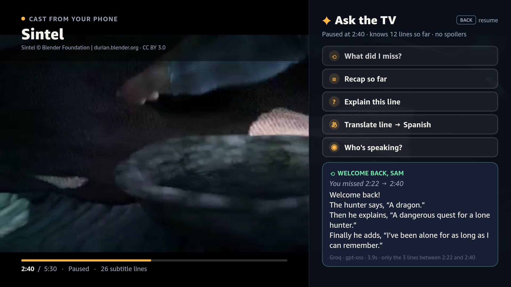
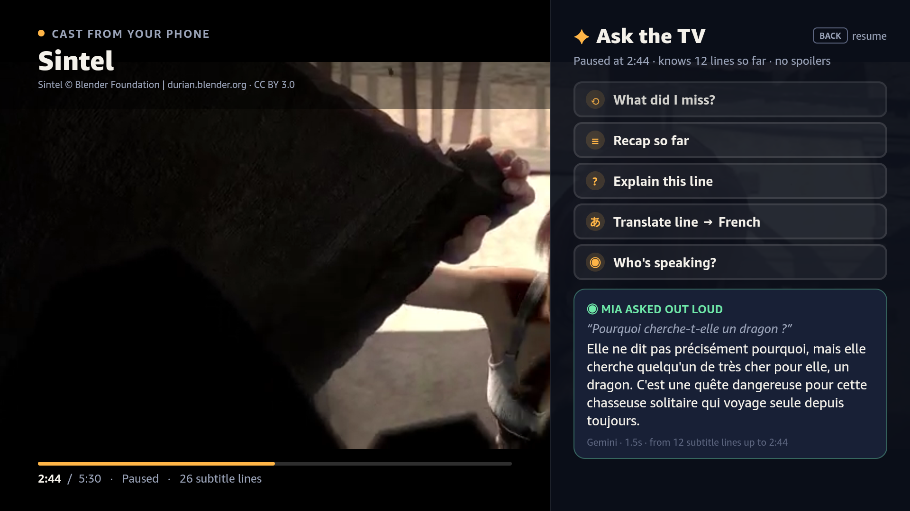
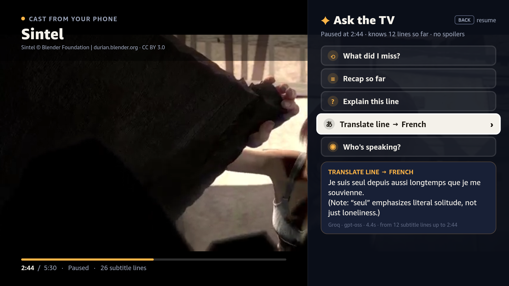
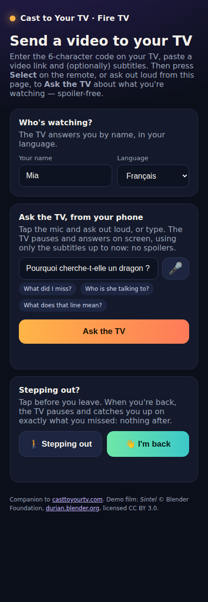
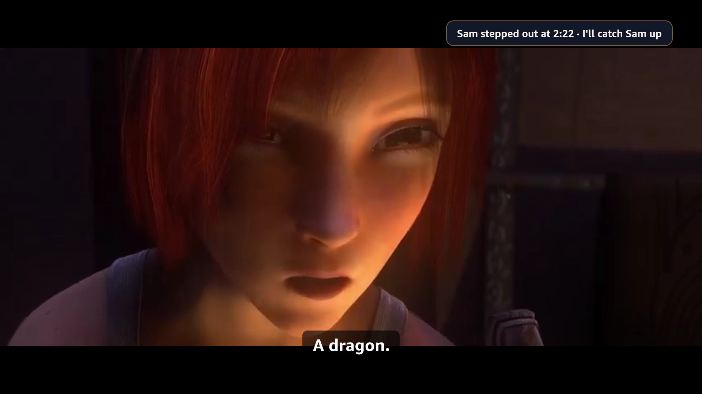

# Cast to Your TV for Fire TV (Vega OS)

[](https://github.com/OlsOls4/casttoyourtv-firetv/actions/workflows/firetv.yml)

A Fire TV receiver for [casttoyourtv.com](https://casttoyourtv.com/), built with **React Native for Vega** (Vega OS / SDK 0.24) for the Amazon *Build, Ship, Shape* hackathon (Fire TV track).

You scan a QR code on the TV and send a video and its subtitles from your phone. Then the hook: **Ask the TV**. Press **Select** while watching and the film pauses. A side panel opens with questions you pick with the D-pad:

| Chip | What you get |
|---|---|
| **What did I miss?** | A 2–3 sentence catch-up on the last minute or so |
| **Recap so far** / **Recap last 5 min** | Three short bullets (the label says "so far" until five minutes have played) |
| **Explain this line** | The meaning and subtext of the line just spoken |
| **Translate line → French** | The latest line in the household's language, plus a note on nuance. The target is the language of the last viewer who cast or asked from their phone (Spanish when that viewer uses English) and the chip names it |
| **Who's speaking?** | The most likely speaker, with the clue in the dialogue |

The answer card always belongs to the focused chip: move focus and a stale answer clears ("Press SELECT to ask …").

**The phone is everyone's own remote.** The page you cast from (`/s/?code=…`) lets each viewer:

* **Say who's watching:** a name and a language (English, Español, Français, Deutsch, Polski, हिन्दी, 日本語), remembered on that phone.
* **Ask out loud or by typing** (Web Speech API). The TV pauses and shows *"MIA ASKED OUT LOUD"* with Mia's question, and answers **in Mia's language**.
* **Tap "Stepping out" / "I'm back".** The TV notes the moment you left (*"Sam stepped out at 2:26 · I'll catch Sam up"*) and keeps playing for everyone else. When you tap *I'm back*, it pauses and shows *"Welcome back, Sam · You missed 2:26 → 2:38"* with a recap of **only the subtitle lines in that stretch**: nothing before you left, nothing after now.

Vega has no app-level speech-to-text yet, so the phone acts as the microphone while the remote stays the shared control.

**No spoilers, by construction.** The model only sees subtitle cues that have already started, filtered on the TV (`cuesUpTo`) and again on the server (`spoilerSafe`). `server/test/ask-core.test.js` proves, for every mode including the missed-stretch recap, that no cue after the pause point reaches the prompt, and CI runs it on every push.



| | |
|---|---|
|  |  |
|  |  |

▶ **Narrated demo video (YouTube):** https://youtu.be/g30fh212Bm0 

[](https://youtu.be/g30fh212Bm0)

Raw CI recordings from the VVD: [docs/ask-the-tv-demo.mp4](docs/ask-the-tv-demo.mp4) (pair, cast, five chips, phone question) and [docs/household-demo.mp4](docs/household-demo.mp4) (stepping out / I'm back, a viewer asking in French, Translate → French, Back twice to exit)

## Who it's for and why it matters

- **50%** of Americans watch with subtitles most of the time (**70%** of Gen Z). The top reasons are muddled audio and accents. ([Preply](https://preply.com/en/blog/americas-subtitles-use/))
- **42%** of UK viewers use subtitles to concentrate. **12 million** people in the UK are deaf, deafened or hard of hearing. ([Stagetext](https://www.stagetext.org/news/research-shows-42-of-people-say-concentration-is-a-reason-to-use-subtitles/))
- **68% (UK) / 64% (US)** of TV viewers use another device while watching. ([YouGov](https://yougov.com/en-us/articles/33396-multi-screening-global-poll), 2020)

Ask the TV keeps the answer on the big screen, spoiler-free. It's built for:

- **Households watching together.** Anyone can press Select or ask from their own phone. Whoever steps out gets a catch-up on exactly what they missed when they're back, without anyone rewinding.
- **Deaf and hard-of-hearing viewers**, who already rely on subtitles: the same subtitles become catch-ups and "who's speaking?" answers.
- **Non-native speakers and language learners.** Each viewer gets answers in their own language. *Explain this line* unpacks idioms and subtext, and *Translate line* adds a note on nuance.

Amazon's own [X-Ray Recaps](https://www.aboutamazon.com/news/entertainment/amazon-prime-video-x-ray-recaps) showed that viewers want spoiler-free AI catch-ups built from dialogue, for Amazon MGM Original series inside Prime Video. Ask the TV brings the idea to any video a household casts with a subtitle file (films you own, lectures, foreign-language titles, Creative Commons films), and adds what a recap screen can't: your own question by voice, explain or translate this exact line, who's speaking, and a recap of exactly the stretch *you* missed.

## Vega APIs used

| Vega API | File | What it does here |
|---|---|---|
| W3C Media `VideoPlayer` (`@amazon-devices/react-native-w3cmedia`) | [`app/src/ct/PlayerScreen.tsx`](app/src/ct/PlayerScreen.tsx) (`onSurfaceViewCreated`) | `initialize()` → `setSurfaceHandle()` → `src`/`autoplay`, seek on `loadedmetadata`, `play()`/`pause()`, `clearSurfaceHandle()` → `deinitialize()` on destroy |
| `KeplerVideoSurfaceView` | `PlayerScreen.tsx` | The video surface, with our subtitle overlay and Ask panel drawn on top |
| Vega Media Controls: `KeplerMediaControlHandler` + `VideoPlayer.setMediaControlFocus()` | [`app/src/ct/mediaControls.ts`](app/src/ct/mediaControls.ts), `PlayerScreen.tsx` | Registers a handler with `setMediaControlFocus()` (as in Amazon's vega-video-sample) that maps system play / pause / toggle / seek / skip / fast-forward / rewind to our player, with one toggle per press even when the key also arrives through `useTVEventHandler`. It builds and runs in the green CI demo; the VVD can't send Alexa transport, so we haven't seen the system call it yet |
| `useComponentInstance` (`@amazon-devices/react-native-kepler`) | `PlayerScreen.tsx` | The component instance that media-control focus is set for |
| `useTVEventHandler` | `PlayerScreen.tsx` | Remote keys on the player: menu = Ask, play/pause, ◀ ▶ / rewind / fast-forward = seek ±10 s (key-down only) |
| `BackHandler` (`hardwareBackPress`) | `PlayerScreen.tsx` | Back closes the Ask panel; on the player, the first Back shows "Press Back again to exit" and a second within 4 s exits |
| `AppState` | `PlayerScreen.tsx`, [`app/src/ct/PairScreen.tsx`](app/src/ct/PairScreen.tsx) | In the background: pause and stop the 2 s relay polling. Back to active: polling restarts, playback stays paused until you press play |
| TV focus: `hasTVPreferredFocus`, `onFocus`/`onBlur` on `TouchableOpacity` | [`app/src/ct/ui.tsx`](app/src/ct/ui.tsx), [`app/src/ct/AskPanel.tsx`](app/src/ct/AskPanel.tsx) | D-pad focus states (fill, border, scale, "›"). The answer card follows the focused chip; a phone answer draws the focus "quiet" so no chip looks selected |
| `manifest.toml` media services | [`app/manifest.toml`](app/manifest.toml) | `com.amazon.media.server`, `media.playersession.service`, `mediabuffer.service`, `mediatransform.service`, audio stream/control, network, inputd |
| VVD tooling: `vega run-app`, `inputd-cli button_press`, emulator console `screenrecord`, `loggingctl` | [`ci/scripts/demo.sh`](ci/scripts/demo.sh) via [vega-vvd-ci](https://github.com/OlsOls4/vega-vvd-ci) | Install and launch, remote-key presses, 1080p recordings, device logs, all in CI |

Real log lines from the green CI run ([run 39945908768](https://github.com/OlsOls4/casttoyourtv-firetv/actions/runs/39945908768)):

```
# device log (loggingctl, filtered to our package) during the demo: the Vega media pipeline playing the cast
Oct 23 11:18:02.429253 com.olsols4.casttoyourtv[3725]: I MEDIA_PLAYER:DefaultMediaPlayer.cpp(4594) bus_call Pipeline is buffering v[100%], a[  2%], source [audio-queue]
Oct 23 11:18:03.008928 com.olsols4.casttoyourtv[3725]: INFO com.amazon.keplerscript: [KeplerScript-JavaScript] render KeplerVideoSurfaceView
# CI demo log: the headless phone page driving the household features through the relay
phone sam-away: Got it. The TV noted when Sam left. Tap “I'm back” when you return.
phone sam-back: Welcome back! Look at the TV for your catch-up.
phone mia-ask: Asked! Look at your TV.
PLAYBACK: confirmed by the Vega media pipeline in com.olsols4.casttoyourtv
```

## Demo and screenshots

Every CI run ([latest green run](https://github.com/OlsOls4/casttoyourtv-firetv/actions/runs/39945908768)) boots the **Vega Virtual Device** on a free GitHub-hosted runner and drives the app with remote-key presses, while a headless Chrome plays the phone:

1. pair screen
2. the web sender page opened from the QR link casts through the relay
3. playback with subtitles
4. Ask the TV: all five chips
5. a free question asked from the phone page
6. **Sam taps "Stepping out"**, the film keeps playing, Sam taps **"I'm back"**: the TV pauses and recaps only that stretch
7. **Mia (French) asks from her phone**: the answer comes back in French; moving focus clears it; **Translate line → French**
8. Back resumes, Back once shows "Press Back again to exit", Back again exits
9. Home sends the app to the background (lifecycle)

The run uploads step screenshots, two 1080p MP4s and the `.vpkg` as the `firetv-demo` artifact ([Actions](https://github.com/OlsOls4/casttoyourtv-firetv/actions)). Selected frames live in [`docs/`](docs/).

## Honest limits (and the plan)

| Today | Plan |
|---|---|
| Works on video cast as a URL with an SRT/VTT file, not inside third-party streaming apps | Keep the focus on what households can cast with subtitles: films they own, lectures, foreign-language and Creative Commons titles |
| Relay state lives in a warm serverless function's memory, so a cold start can drop a pending cast or question | Redis/KV-backed relay |
| Answers come from Gemini Flash-Lite, then Groq (gpt-oss-20b) if Gemini is slow or overloaded, then deterministic offline answers | Keep the chain; offline answers mean the TV never dead-ends |
| Voice goes through the phone | Remote-mic voice once Vega exposes app-level speech-to-text (see our feature request in the friction log) |
| Tested on the Vega Virtual Device only | Test on a Vega Fire TV Stick before an Appstore submission |

## Roadmap to the Amazon Appstore

1. Appstore submission of the Vega build
2. Persistent relay
3. Ask the TV as a casttoyourtv.com Plus/Pro feature (casting stays free; the deterministic offline answers stay on the free tier)
4. One-press voice on the Fire TV remote once Vega exposes an app-level speech API

## Architecture

```
 Phone / browser                       Vercel (serverless, free tier)                 Fire TV (Vega OS)
 ───────────────                       ───────────────────────────────                ─────────────────
 /s/?code=ABC123  ── POST cast ──►  /api/relay  ◄── GET poll every 2 s ───  Pair screen (QR + 6-char code)
 (web sender:                       (code → cast; questions, away/back,     │ cast received
  name+language,                     viewer events; no polling in background)
  ask, step out/back)
                                                                                 ▼
                                    /media/* (demo MP4, SRT, poster)  ◄──  Player: W3C Media VideoPlayer
                                                                           + KeplerVideoSurfaceView
                                                                           + our own SRT/VTT cue overlay
                                                                                 │ Select = pause + Ask
                                    /api/ask  ◄── {mode, t, cues ≤ t} ────  Ask the TV panel (D-pad chips)
                                    Gemini (or Groq) with a strict              ▲
                                    "only these lines, no spoilers"             └─ offline fallback answers
                                    prompt → short answer                          if the network fails
```

* **App** (`app/`, generated with `vega project generate --template helloWorld`, then customised):
  * `src/App.tsx`: switches between the pair screen and the player.
  * `src/ct/PairScreen.tsx`: 10-foot pair screen. Big QR code (rendered with plain Views from `qrcode-generator`), the 6-character code, a live relay status, and D-pad-focusable **Play the demo film** and **New code** buttons.
  * `src/ct/PlayerScreen.tsx`: playback through `@amazon-devices/react-native-w3cmedia` (`VideoPlayer` + `KeplerVideoSurfaceView`). Subtitles are parsed by our own SRT/WebVTT parser (`subtitles.ts`) and drawn as an overlay. Left/right seek ±10 s, play/pause works (remote key or Vega Media Controls), Back closes the panel, and Back twice exits. It handles phone events (questions, *Stepping out* / *I'm back*, who's watching) and the app lifecycle (`AppState`). If the decoder doesn't advance (for example on an emulator without hardware video), a subtitle clock keeps the cues moving so the experience never dead-ends.
  * `src/ct/AskPanel.tsx` + `ask.ts`: the Ask the TV side panel. It sends `POST /api/ask` with only the cues up to the pause point (plus the viewer's name, answer language and, for *I'm back*, the time they stepped out), uses a 12 s timeout, and falls back to deterministic offline answers. The answer card follows the focused chip.
  * `src/ct/mediaControls.ts`: the `KeplerMediaControlHandler` subclass for Vega Media Controls.
* **Backend** (`server/`, deployed at <https://casttoyourtv-firetv.vercel.app>):
  * `api/ask.js` + `lib/ask-core.js`: the spoiler-safe prompt (modes `miss`, `recap`, `explain`, `translate`, `who`, `ask` and `missed`, the stretch between stepping out and now). It tries Gemini Flash-Lite with short per-model timeouts, then Groq (`openai/gpt-oss-20b`), then the offline answer, so a busy model never stalls the TV. `replyLang` sets the answer language, `lang` the translation target. The response includes `source`, `model`, `cuesUsed` and `ms`.
  * `test/ask-core.test.js`: `node --test` checks that no cue after the pause point reaches the prompt in any mode, that the missed-stretch window is exact, and that names and questions are sanitised.
  * `api/relay.js`: the pairing relay. The sender POSTs a cast, a `question` (with `name`/`lang`) or an `event` (`away`, `back`, `viewer`) for a code. The pair screen polls for casts, and the player polls with `&q=1` for phone items. State lives in the warm function's memory (fine for a demo). Swap in Redis/KV for production.
  * `public/s/`: the web sender page that the QR code opens (`/s/?code=XXXXXX`). It casts, remembers each viewer's name and language, asks free questions by voice (Web Speech API, in the viewer's language) or by typing, and has *Stepping out* / *I'm back* buttons.
  * `public/media/`: the demo clip, its subtitles and a poster image.
* **CI** (`.github/workflows/firetv.yml`, `ci/scripts/`):
  * Runs the server tests (`node --test`), then uses the composite action [`OlsOls4/vega-vvd-ci@v1`](https://github.com/OlsOls4/vega-vvd-ci). It installs the Vega SDK, enables KVM and boots the VVD headlessly with non-black captures.
  * `prepare-app.sh` writes the build-time config (a fixed pairing code per run, so CI can cast to it), runs the unit tests (a failure fails the build) and builds `build:release`.
  * `demo.sh` drives the app with `inputd-cli button_press`. It casts through the real web sender page, drives the household features from the same page in headless Chrome, captures screenshots, records two clips with the emulator console's `screenrecord`, and checks the device log for the media pipeline running in our app.

## Run it yourself

**On a machine with the Vega SDK 0.24 and Node 22 (Linux x86_64 or macOS):**

```bash
cd app
npm install
npm run build:release                      # -> build/x86_64-release/casttoyourtv_x86_64.vpkg (+ aarch64/armv7)
vega virtual-device start
vega run-app build/x86_64-release/casttoyourtv_x86_64.vpkg com.olsols4.casttoyourtv.main -d VirtualDevice
npx jest                                   # unit tests (subtitle parser, spoiler-safe offline answers, honest labels)
cd .. && node --test server/test/*.test.js # spoiler-boundary tests for the server prompt
```

Remote keys:

| Key | Action |
|---|---|
| **Select** | Ask the TV (on the player) |
| **▲ ▼** | Move between questions |
| **Back** | Close the panel and resume; on the player, press twice to exit |
| **Play/Pause** | Pause or resume (also via Vega Media Controls) |
| **◀ ▶** | Seek ±10 s |

**In CI only (no local SDK needed):** push to `main`, or run the workflow from the Actions tab. Tick *offline-ask* to force the deterministic answers.

**Backend:**

```bash
cd server && npx vercel deploy --prod
```

Set `GEMINI_API_KEY` and/or `GROQ_API_KEY` as encrypted env vars (the live deployment has both: Gemini first, Groq as the fallback). `GET /api/health` shows which keys are configured.

Try the API:

```bash
curl -s https://casttoyourtv-firetv.vercel.app/api/ask -H 'content-type: application/json' \
  -d '{"mode":"recap","t":150,"title":"Sintel","cues":[{"s":107,"e":110,"text":"This blade has a dark past."},{"s":143,"e":145,"text":"A dragon."}]}'
```

## Friction log

Everything that slowed us down with the Vega SDK, the VVD and the submission is in [docs/FRICTION_LOG.md](docs/FRICTION_LOG.md), with severity, workaround and a suggestion for each.

## Credits

* **Sintel**: © copyright Blender Foundation | [durian.blender.org](https://durian.blender.org/), licensed under [Creative Commons Attribution 3.0](https://creativecommons.org/licenses/by/3.0/). The demo clip is the first 5:30 of the film, re-encoded to 480p. The subtitles are the official English subtitles from durian.blender.org.
* VVD-in-CI technique: [finloop/vega-virtual-device-action](https://github.com/finloop/vega-virtual-device-action) and [software-mansion/argent](https://github.com/software-mansion/argent), packaged in [OlsOls4/vega-vvd-ci](https://github.com/OlsOls4/vega-vvd-ci).
* QR codes: [`qrcode-generator`](https://github.com/kazuhikoarase/qrcode-generator) (MIT).
* Built with the Amazon Vega SDK and React Native for Vega.

## License

MIT © 2026 Olly McBride. See [LICENSE](LICENSE). The Sintel media keeps its own CC BY 3.0 licence.
